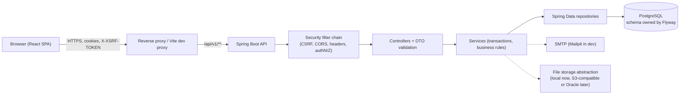

# Architecture

## Style

A **modular monolith**: one deployable Spring Boot application with feature modules under the base package
`com.schoolmanagement`, and one React single-page application served separately (or behind the same
reverse proxy). Modules own their controllers, services, repositories, entities, DTOs and mappers; shared
infrastructure lives in `common`, `config` and `security`.

Phase 1 contains only the shared infrastructure. Feature modules (`auth`, `user`, `student`, `guardian`,
`teacher`, `academic`, `attendance`, `timetable`, `assignment`, `examination`, `announcement`, `fee`,
`audit`, `file`, `notification`) are added phase by phase so that no empty placeholder packages exist.

## Backend layout

| Package | Responsibility |
| ------- | -------------- |
| `com.schoolmanagement` | Application entry point |
| `config` | Typed properties (`app.cors`, `app.pagination`, `app.security`), `Clock`, JPA auditing, async/scheduling |
| `security` | Filter chain, CORS, CSRF cookie filter, JWT config, cookie access-token filter, 401/403 problem responses, `PasswordEncoder` |
| `auth` | `controller` (endpoints, cookies), `service` (login, refresh rotation, password flows, rate limiter), `entity`/`repository` (refresh and reset tokens), `dto`, `validation` (`@StrongPassword`) |
| `academic` | `controller` (admin endpoints), `service` (rules, audit), `entity`, `repository` (Spring Data + specifications), `dto` for years, grades, subjects, sections and subject assignments |
| `user` | `User`, `Role`, `AccountStatus`, repositories, `UserProvisioner`, `TeacherDirectory` (teacher lookup for assignments), `bootstrap` (dev demo data, optional first admin) |
| `school` | `School` entity and repository |
| `audit` | `AuditEvent`, publisher, `AuditSanitizer`, the immutable `AuditLog` entity, the persisting listener (written with the business transaction) and the logging listener, plus the read-only `AuditLogController` |
| `dashboard` | One read-only endpoint per role that composes the existing services into the numbers on each home page |
| `notification` | `EmailService` (asynchronous, Mailpit in development) |
| `common.persistence` | `AuditableEntity` (UUID id, `createdAt`, `updatedAt`, `@Version`) |
| `common.exception` | `GlobalExceptionHandler`, domain exceptions, RFC 7807 builder |
| `common.api` | `PageResponse`, `PageRequestFactory` (bounded, whitelisted paging/sorting) |
| `common.web` | `TraceIdFilter` (server-generated `X-Trace-Id`, logged via MDC) |
| `common.system` | Public `GET /api/v1/system/info` used by the frontend shell |

Conventions (UUID keys, `Instant`/`LocalDate`, `BigDecimal` money, DTOs only, service-layer
transactions, pagination everywhere) are in the repository instructions and apply to every module.

## Frontend layout

`src/api` (Axios client with one controlled refresh, error normalisation, auth calls), `src/app` (providers,
theme, query client), `src/auth` (auth context/provider, role helpers, route guards), `src/layouts` (role and
auth layouts, responsive navigation), `src/components`, `src/hooks`, `src/pages` (`auth/`, `admin/`,
`teacher/`, `student/`), `src/routes`, `src/features/*` (per-feature code from Phase 3), `src/schemas` (Zod),
`src/types`, `src/utils`.

Responsive rules: temporary drawer + menu button below `md` (900px), permanent drawer from `md`,
44px minimum touch targets, no page-level horizontal overflow.

## Key decisions and assumptions

- **Spring Boot 3.5.x** (the specification requires 3.x; start.spring.io now only offers 4.x).
- **Vite 6 / Vitest 3 / jsdom 26** because the development machine runs Node 20.9; newer majors require
  Node 20.19+ or 22.12+. CI uses Node 22 and can upgrade independently.
- **Authentication:** JWT access token plus opaque rotating refresh token, both in `HttpOnly` cookies. The
  access-token filter is a plain security-chain filter (not the OAuth2 resource-server starter) so an invalid or
  expired cookie leaves a request anonymous instead of failing public endpoints. Only `spring-security-oauth2-jose`
  (Nimbus) is used for signing and verification.
- **Account state is checked on every request** (one indexed query) rather than trusted from the token.
- **Login identifier:** `users.username` holds the admission number / employee ID. It is set when an
  administrator creates a student or teacher, and cannot be edited afterwards.
- **Audit:** events are published as Spring events by the services. A persisting listener writes each one to
  `audit_logs` (V11) just before the publishing transaction commits, so the trail and the change succeed or fail
  together; a logging listener keeps an operational copy. Values are sanitized, rows are immutable, and the only
  access is the read-only administrator API.
- **Dashboards compose, they do not duplicate.** `DashboardService` calls the same services and repositories as the
  feature screens (timetable, assignments, marks, results, fees, announcements), scoped to the caller, so a number on
  the home page cannot disagree with the page it links to.
- **Last-admin protection:** an administrator cannot change their own status, and disabling an administrator
  first locks all active administrator rows (`FOR UPDATE`) so two concurrent requests cannot remove the last one.
- **Demo data:** the dev seeds create users and the school, plus (Phase 3) one active year, Grade 8, section A
  and five subjects, and (Phase 4) teacher and student profiles, a guardian and an enrollment. They only run
  against a local database.
- **Teachers are referenced by user id** in sections and subject assignments; `teacher_profiles` link to the same
  user. Assignments require an *active* teacher account whose employment status, if a profile exists, is `ACTIVE`.
- **Academic year lifecycle:** `PLANNED` -> `ACTIVE` -> `CLOSED`, one-way. Activation never closes another year
  automatically, so the administrator makes the irreversible choice explicitly. A closed year freezes its sections
  and assignments, and nothing can be enrolled into it.
- **Optimistic locking in the API:** update requests carry the `version` the user last saw; a mismatch is a
  `409` the UI explains. Concurrent duplicates are also caught by unique indexes. Student and teacher edits also
  change the user row, so the profile version is bumped on every edit (`PESSIMISTIC_FORCE_INCREMENT`).
- **Enrollment is history:** rows are ended (transferred, promoted, withdrawn, completed), never edited or
  deleted. Capacity is checked while the section rows are locked; see [database-model.md](database-model.md).
- **Promotion runs in one transaction** but reports each student's outcome instead of failing as a whole, so a
  full section does not block the rest of the batch. A run is limited to 500 students.
- **Guardians have no sign-in account yet**; they are contact records linked to students.
- **Not yet enforced:** substitute teachers and teacher leave are not modelled in the timetable.
- **Timetable teacher** is stored on each slot (copied from the subject assignment when left blank), so the
  clash check and the teacher's weekly view are single-table queries. Changing an assignment's teacher does not
  rewrite existing slots.
- **Attendance authority:** the class teacher takes the daily register and the subject teacher takes their
  subject's register; this is decided from the section and assignment rows on every request, never from the
  client. Teachers work within a back-dating window; administrators correct anything, with a reason and a
  permanent history row, in addition to the audit trail.
- **Attendance percentage** is computed in the database over finalized registers only (present and late count
  as attended, half day as half, excused days are left out). `AttendanceTally` holds the rule and has unit tests.
- **File storage is an interface** (`file.FileStorage`: `store`, `open`, `delete`) with a local-disk provider
  selected by `app.uploads.provider`. Services never see paths, only random keys, so an S3-compatible or Oracle
  provider can be added as another `@ConditionalOnProperty` bean without touching `assignment`. `UploadValidator`
  decides what is acceptable and `UploadService` ties storage to the database transaction: it validates a whole
  request before storing anything, deletes the files it stored if the transaction rolls back, and deletes the
  files of removed records only after the commit. Object storage would add a periodic sweep for unreferenced
  keys, because a crash between commit and delete can leave one.
- **Assignment lifecycle** is `DRAFT` > `PUBLISHED` > `CLOSED` > `ARCHIVED`, decided in `AssignmentService`.
  Ownership is always derived from the signed-in teacher's `section_subjects` rows, never from client input. A
  submission is one row per student (replaced on resubmission) whose `LATE` flag is set when it is handed in
  after the due date, so a later change of the due date does not rewrite history.
- **Exams belong to a grade and year, not a class.** One exam covers every class of the grade; which subjects a
  student is marked in comes from the subject assignments of *their* class, so a class that does not take a subject
  simply has no line for it. Marks are saved per subject and class by the teacher of that pair, under a shared lock on
  the exam row; lock and publish take the exclusive lock, which is what makes "locked" mean no further changes.
- **Results are calculated by one pure class** (`ResultCalculator`, unit tested) and **frozen at publication** into
  `exam_results`. Before publication an administrator sees the same calculation as a preview. Freezing means a later
  edit of the grade scale, a renamed subject or a moved student cannot change a published report card; correcting a
  published exam is deliberately not supported (it would need an audited re-publication workflow).
- **Absent students** score zero in that subject, keep its maximum in the total, and fail the subject. Locking
  refuses an exam with a missing entry, so "not entered" can never be mistaken for "absent" or zero.
- **Report cards are printable React pages** (print stylesheet, `window.print()`) fed by the report-card JSON, not
  server-rendered HTML, so the API keeps its strict `default-src 'none'` content security policy.
- **Announcements are visible by rule, not by request.** The feed is one query built from the viewer's roles, enrolled
  classes and teaching assignments, plus the publish and expiry window; read receipts are insert-or-ignore.
  Scheduled announcements need no job: they simply start matching the query when their time comes.
- **Fees are a ledger.** A fee structure is the price list; generating it copies amount, category and due date into
  each student's bill, so later price changes never rewrite history. Payments are append-only and a reversal is its
  own row. `paid_amount` is kept on the bill under a row lock for fast queries; it always equals the sum of the
  payments that have not been reversed. The status is derived from amount, payments, waiver and the school's
  "today" (one rule class, used for display and for filtering), so no job rolls bills from due to overdue.
- **Frontend list pattern:** `DataList` renders a table from 900px and cards below it; forms live in
  dialogs that become full screen on phones; server state is kept in TanStack Query under one root key per feature
  (`academics`, `people`) so a single invalidation refreshes lists and dropdowns.
- **Lombok and MapStruct are not added yet**; they will be introduced only where they pay off.
- **Integration tests** run on Testcontainers PostgreSQL, or on a throwaway database given by `IT_DB_URL` when
  Docker is unavailable.
