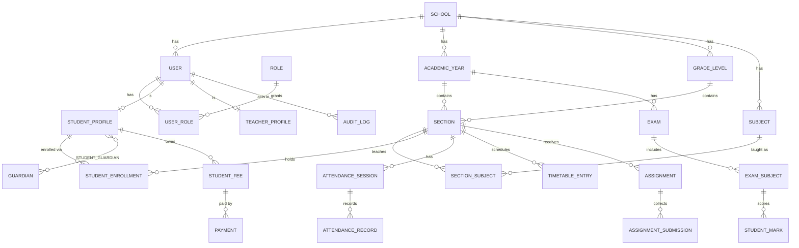

# Database model

PostgreSQL schema is owned by Flyway (`backend/src/main/resources/db/migration`). Hibernate runs with
`ddl-auto=validate`. Released migrations are never edited; corrections are new migrations.

Planned migration sequence (added with the corresponding phase):

| Migration | Content | Phase |
| --------- | ------- | ----- |
| V1 | school, users, roles, user_roles, refresh tokens, password-reset tokens | 2 (done) |
| V2 | academic years, grade levels, sections, subjects, section subjects | 3 (done) |
| V3 | student profiles, guardians, student guardians, enrollments, promotion batches | 4 (done) |
| V4 | teacher profiles | 4 (done) |
| V5 | attendance sessions, records and corrections | 5 (done) |
| V6 | timetable entries | 5 (done) |
| V7 | assignments, attachments, submissions | 6 |
| V8 | exams, exam subjects, marks, grade rules | 7 |
| V9 | announcements and reads | 8 |
| V10 | fee categories, structures, student fees, payments | 8 |
| V11 | audit logs | 9 |

Conventions: UUID primary keys, `school_id` on major tables, `created_at`/`updated_at` as UTC
`timestamptz`, `version` for optimistic locking, `numeric(12,2)` for money, foreign keys, unique and check
constraints, indexes on filtered columns.

## Implemented in V1

| Table | Notes |
| ----- | ----- |
| `schools` | Unique `school_code`; one row for the first release, `school_id` is carried everywhere for later multi-school support |
| `roles` | Reference data seeded by the migration: `ROLE_ADMIN`, `ROLE_TEACHER`, `ROLE_STUDENT` (check constraint) |
| `users` | Case-insensitive unique `(school_id, lower(email))` and `(school_id, lower(username))` (username optional: admission number or employee ID); `account_status` check constraint; `failed_login_attempts`, `locked_until`, optimistic-lock `version` |
| `user_roles` | Join table; removing a user cascades |
| `refresh_tokens` | `token_hash` (SHA-256, unique), `family_id` for reuse detection, `expires_at`, `revoked_at`, client IP and user agent |
| `password_reset_tokens` | `token_hash` (SHA-256, unique), `expires_at`, `used_at` (single use) |

Only hashes of tokens are stored. Expired token rows are purged by scheduled jobs.

## Implemented in V2

| Table | Constraints worth knowing |
| ----- | ------------------------- |
| `academic_years` | Dates checked (`end_date > start_date`); status check (`PLANNED`, `ACTIVE`, `CLOSED`); unique `(school_id, lower(name))`; **partial unique index `uq_academic_years_one_active` allows only one `ACTIVE` year per school**, a database backstop to the service rule |
| `grade_levels` | Unique `(school_id, lower(name))`; `display_order >= 0` |
| `subjects` | Unique `(school_id, lower(code))` (codes are stored upper case) |
| `sections` | Unique `(academic_year_id, grade_level_id, lower(name))`; `capacity` 1-500; `class_teacher_id` references `users`; `unique (id, academic_year_id)` supports the composite key below |
| `section_subjects` | Unique `(section_id, subject_id)`; `weekly_periods` 1-40; `teacher_id` references `users`; **composite FK `(section_id, academic_year_id)` to `sections(id, academic_year_id)` guarantees the assignment's year equals its section's year** |

Teachers are referenced by their **user account** (`users.id`); the teacher profile table added later links to
the same user, so no data migration is needed. Deleting grades, subjects, sections and years that are in use is
refused (foreign keys use the default `RESTRICT`; services check first and return a friendly conflict).

## Implemented in V3 and V4

| Table | Constraints worth knowing |
| ----- | ------------------------- |
| `student_profiles` | One per user (`unique user_id`); unique `(school_id, lower(admission_number))`; gender, status (`ACTIVE`, `INACTIVE`, `WITHDRAWN`, `GRADUATED`) and blood group checks; `admission_date >= date_of_birth`; `profile_photo_key` is reserved for file storage in a later phase |
| `guardians` | Separate from users (guardians do not sign in yet); relationship check; no uniqueness on phone or email, because families share contacts |
| `student_guardians` | Unique `(student_id, guardian_id)`; **partial unique index `uq_student_guardians_one_primary` allows one primary guardian per student** |
| `student_enrollments` | History rows, never deleted. **Composite FK `(section_id, academic_year_id, grade_level_id)` to `sections`** keeps the denormalised year and grade equal to the section's. **Partial unique indexes: one `ACTIVE` enrollment per student and year, and one `ACTIVE` roll number per section.** `source_enrollment_id` links a transfer or promotion to the row it replaced; `promotion_batch_id` links to the run |
| `promotion_batches` | Who ran a promotion and when, with total, promoted and failed counts (`promoted + failed = total`) |
| `teacher_profiles` | One per user; unique `(school_id, lower(employee_id))`; employment status check (`ACTIVE`, `ON_LEAVE`, `RESIGNED`, `RETIRED`) |

V3 also adds `unique (id, academic_year_id, grade_level_id)` on `sections` for the enrollment key. The admission
number or employee ID is also stored as the user's `username` (the sign-in ID), so it is unique across users.
Capacity is not a database constraint: enrollment locks the target section rows (`SELECT ... FOR UPDATE`, in id
order) before counting active enrollments, so concurrent requests cannot oversubscribe a section.

## Implemented in V5 and V6

| Table | Constraints worth knowing |
| ----- | ------------------------- |
| `attendance_sessions` | **Composite FK `(section_id, academic_year_id)` to `sections`**. `session_type` is `DAILY` (no subject, no period) or `SUBJECT` (subject required), checked. **Partial unique indexes: one daily session per section and date, and one subject session per section, date, subject and period** (`coalesce(period_number, 0)`). Status `OPEN` or `FINALIZED`; a check keeps `finalized_by` and `finalized_at` set exactly when finalized |
| `attendance_records` | `unique (session_id, student_id)`: one mark per student and session. Statuses `PRESENT`, `ABSENT`, `LATE`, `HALF_DAY`, `EXCUSED`. Deleting a session removes its records (`on delete cascade`); the service allows that only while it is open |
| `attendance_corrections` | Append-only history of administrator changes: previous status (null when the student had no mark), new status, reason, who. Never updated or deleted by the application |
| `timetable_entries` | **Composite FK `(section_id, academic_year_id)` to `sections`**; weekday and status checks; period 1-20; `end_time > start_time`; `effective_to >= effective_from`. Overlaps cannot be a plain constraint (they depend on teacher, class or room and on date ranges), so the service checks them under a per-school advisory lock |

"Enrolled" is checked by the service against the active enrollments at the time of marking; the database cannot
express it. Enrollments carry no end date, so past registers are not re-checked against historical rosters.

## Implemented in V7

| Table | Constraints worth knowing |
| ----- | ------------------------- |
| `assignments` | **Composite FK `(section_id, academic_year_id)` to `sections`**. Status `DRAFT`, `PUBLISHED`, `CLOSED` or `ARCHIVED`; `max_marks` above 0 and at most 1000 (`numeric(6,2)`); a check requires `published_at` once the status is past `DRAFT`. `teacher_id` is the user who set the work; indexed by teacher, section and school year |
| `assignment_attachments` | Metadata only: display name, content type, size (above 0), uploader and a **unique `storage_key`**. Deleted with the assignment (`on delete cascade`); the files are removed by the application after the commit |
| `assignment_submissions` | **`unique (assignment_id, student_id)`**: one submission per student, replaced on resubmission. Status `SUBMITTED`, `LATE`, `REVIEWED` or `RESUBMISSION_REQUESTED`; a check allows marks only when `REVIEWED` and then requires the reviewer and review time. Not cascaded: an assignment with submissions cannot be deleted |
| `submission_attachments` | Same shape as `assignment_attachments`, deleted with the submission |

Rows hold only the storage key, never a path; see [architecture.md](architecture.md) for how files are stored.
"Marks within the maximum" and "student is enrolled in the class" are checked by the service (the database cannot
express them), and a student's submission rows survive later changes of enrollment.

## Implemented in V8, V9 and V10

| Table | Constraints worth knowing |
| ----- | ------------------------- |
| `grade_rules` | Inclusive percentage range with two decimals (`0 <= min <= max <= 100`); grade name unique per school ignoring case. **Overlaps cannot be a plain constraint** without an extension, so the service checks them under a per-school advisory lock |
| `exams` | One per school, year, grade and lower-cased name (unique index); status `DRAFT`, `OPEN_FOR_MARKS`, `LOCKED`, `PUBLISHED`; `PUBLISHED` requires `published_at`; `end_date >= start_date` |
| `exam_subjects` | `unique (exam_id, subject_id)`; `0 < max_marks <= 1000` and `0 <= pass_marks <= max_marks`; deleted with the draft exam |
| `student_marks` | `unique (exam_subject_id, student_id)`; a check allows either **absent with no marks** or **present with marks >= 0**. A row exists only once something was entered; clearing deletes it. The maximum is enforced by the service |
| `exam_comments` | One class-teacher comment per student and exam |
| `exam_results` | **Frozen copy written when an exam is published**: totals, percentage, grade and pass/fail per student, plus the subject lines as `jsonb` and the class name as it was. Later changes to the grade scale or to names do not touch it. `unique (exam_id, student_id)` |
| `announcements` | Audience `ALL`, `ADMINS`, `TEACHERS`, `STUDENTS` or `SECTION`; **a check ties `section_id` to the `SECTION` audience** (set exactly then); `expires_at > publish_at`; published rows carry `published_at` |
| `announcement_reads` | `unique (announcement_id, user_id)`: a read receipt is written with an insert-or-ignore, so reading twice or at the same moment is harmless |
| `fee_categories` | Name unique per school ignoring case |
| `fee_structures` | `amount > 0`; **`unique (academic_year_id, grade_level_id, fee_category_id, due_date)`**, so a category can be billed in instalments but not twice for the same date |
| `student_fees` | `unique (student_id, fee_structure_id)` makes billing repeatable. Amount, category name and due date are **copied** from the structure. `0 <= paid_amount <= amount`; a check lets a fee be waived only with no payments and a reason. The status is *not* stored (see [api-conventions.md](api-conventions.md)) |
| `payments` | Never updated or deleted by the application. `amount > 0`, method check, **`unique (school_id, receipt_number)`** |
| `payment_reversals` | `unique (payment_id)`: a payment is reversed at most once; the payment row is untouched, so the history of both stays |
| `receipt_counters` | Per school and year; the row is updated in the payment's own transaction, so numbers are sequential, unique and not used up by a failed payment |

Money is `numeric(12,2)` everywhere and `BigDecimal` in code. `student_fees.paid_amount` is the sum of payments that
have not been reversed and only changes while the fee row is locked (`SELECT ... FOR UPDATE`), which is what stops
two cashiers from overpaying one fee.

## Implemented in V11

| Table | Constraints worth knowing |
| ----- | ------------------------- |
| `audit_logs` | Append-only trail: `action`, entity type and id, a sanitized `summary`, `old_values` and `new_values` as `jsonb` (credentials redacted), client address and user agent, and the time. `school_id` is null only for events with no school (a sign-in with an unknown account), which no administrator can read. `actor_user_id` is set to null if the user is ever removed, so history outlives accounts. Indexed by school and time, action, entity and actor |

## Core relationships (target model)

This diagram describes the target model; tables appear as their migrations land.
