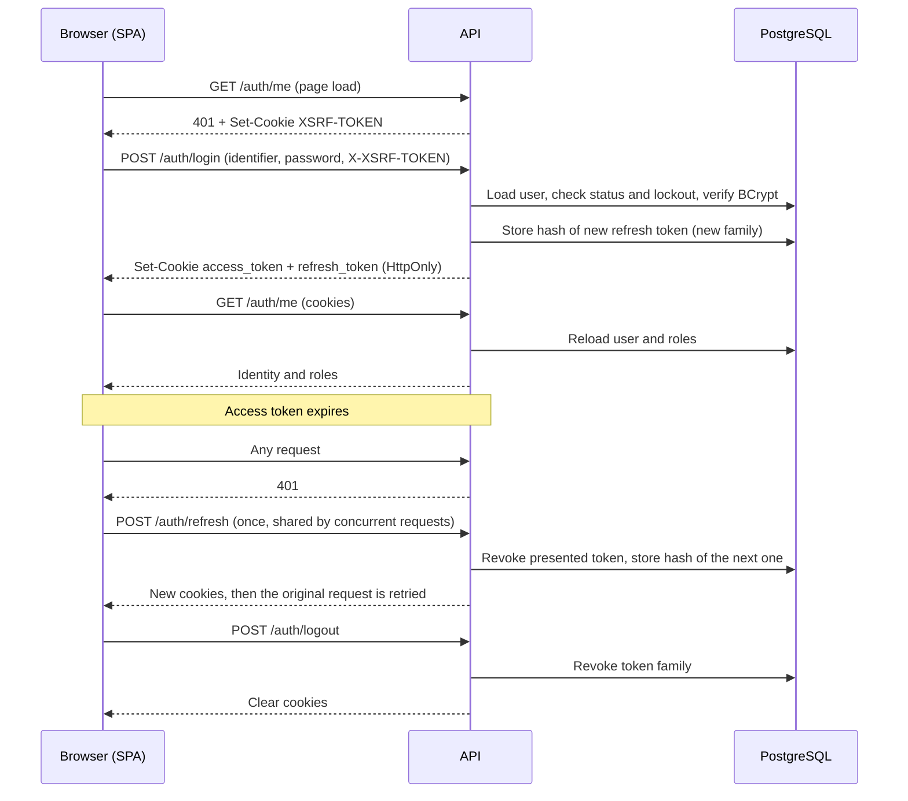

# Security

## Platform baseline

- Spring Security 6, **stateless**, deny-by-default. Public: `GET /api/v1/system/info`, `/actuator/health/**`,
  `/actuator/info`, the OpenAPI/Swagger paths (dev only) and the five unauthenticated auth endpoints below.
  Everything else requires authentication.
- No default Spring user/password (`UserDetailsServiceAutoConfiguration` is excluded); HTTP Basic, form login
  and server-side logout are disabled.
- **CSRF** (cookie authentication needs it): the `XSRF-TOKEN` cookie (readable by the SPA) must be echoed in the
  `X-XSRF-TOKEN` header on state-changing requests; Axios does this (`withXSRFToken: true`). The cookie is issued
  on the first response, including a `401`, so the login page can always post. It follows the same `Secure` /
  `SameSite` settings as the auth cookies.
- **CORS:** explicit origins from `CORS_ALLOWED_ORIGINS`; credentials allowed; wildcards rejected at startup;
  limited to `/api/**`.
- **Headers:** `X-Content-Type-Options`, `X-Frame-Options: DENY`, `Referrer-Policy: no-referrer`,
  `Permissions-Policy`, HSTS on HTTPS, `default-src 'none'` CSP on API responses (relaxed only for Swagger UI).
- **Errors:** RFC 7807 with a server-generated `traceId`; stack traces, SQL and class names stay in server logs.
- Swagger UI: dev only. API docs: dev and test. Both **disabled in `prod`**. Actuator exposes `health` and `info`.
- Secrets come from environment variables; `prod` has no credential defaults.

## Authentication (Phase 2)

| Item | Implementation |
| ---- | -------------- |
| Password hashing | BCrypt. Policy: 10-72 characters (72 is BCrypt's byte limit), upper, lower, digit, special |
| Access token | HS256 JWT, 15 min, in the `access_token` cookie (`HttpOnly`, `Path=/api`) |
| Refresh token | 256-bit random value, 7 days, `refresh_token` cookie (`HttpOnly`, `Path=/api/v1/auth`) |
| Cookie flags | `Secure` (default on; off only in `dev`), `SameSite` from `COOKIE_SAME_SITE` (default `Lax`) |
| Token storage in browser | Never `localStorage` / `sessionStorage`; tokens are never in response bodies |
| Refresh storage | Only the SHA-256 hash is stored (`refresh_tokens.token_hash`) |
| Rotation | Each refresh revokes the presented token and issues a new one in the same *family* |
| Reuse detection | Presenting an already-revoked token (older than a 10 s double-submit grace) revokes the whole family and is audited |
| Logout | Revokes the family of the presented refresh token and clears both cookies |
| Authorization data | The access token only identifies the user. On **every request** the user, status, lockout and roles are reloaded from the database, so suspension, lockout and role changes apply immediately |
| Invalid / expired token | The request is treated as anonymous (public endpoints still work); protected endpoints return `401` |

### Login protections

- Identifier is an **email** or a **username** (admission number / employee ID), case-insensitive. An
  identifier matching more than one account is treated as unknown.
- **Generic failure:** unknown account, wrong password, locked, suspended, pending or archived all return the
  same `401 Invalid credentials.` A BCrypt comparison against a dummy hash runs for unknown accounts so timing
  does not reveal existence.
- **Account lockout:** after 5 consecutive failures the account is locked for 15 minutes (atomic counter in the
  database; failures on an already-locked account do not extend the lock). The correct password is refused
  while locked. A success resets the counter.
- **Rate limiting:** in-memory sliding window per client IP (30 failures / 15 min) and per identifier (10 / 15
  min) returning `429` with `Retry-After`. Password-reset requests: 5 / 15 min per IP, dropped silently.
- Frontend `/login` shows one neutral message for `401` and the server message for `429`.

### Password flows

- **Change password:** requires the current password (throttled per user), rejects reuse, ends every other
  session (all refresh tokens revoked) and starts a fresh one for the caller.
- **Forgot password:** always `202` with the same message. Only `ACTIVE` accounts receive an email. Tokens are
  random, single-use, expire after 30 minutes, are stored hashed, and a new request invalidates earlier ones.
  Mail is sent asynchronously through Mailpit in development. Tokens are never returned by any endpoint and never
  logged.
- **Reset password:** consumes the token atomically (single use even under concurrency), sets the new password
  and revokes all sessions. All token failures (unknown, expired, used, account no longer active) return the same
  `400`.

### Authorization

- URL rules: `/api/v1/admin/**` needs `ROLE_ADMIN`, `/api/v1/teacher/**` needs `ROLE_TEACHER`,
  `/api/v1/student/**` needs `ROLE_STUDENT`. Admin controllers additionally carry
  `@PreAuthorize("hasAuthority('ROLE_ADMIN')")` (defence in depth), and every query is scoped to the caller's
  school, so another school's ids look like `404`. Feature phases add per-endpoint ownership checks in services
  (for example teachers only see their own sections).
- Teachers and students never send an id for themselves: `/api/v1/teacher/timetable` and
  `/api/v1/student/...` always act on the signed-in user. Teacher attendance endpoints re-check on every request
  that the teacher is the class teacher (daily) or the assigned subject teacher, so a session id from another
  class answers `403`. Finalized attendance can only be changed by an administrator, with a recorded reason.
- Assignments follow the same rule: a teacher can create work only for a class and subject they are assigned in
  the active academic year (`403`), and another teacher's assignment or submission answers `404`. A student reaches
  only published or closed assignments of the class they are enrolled in, and only their own submission and files
  (`404` otherwise). Marks stay hidden from the student until the work is reviewed.
- Examinations: a teacher enters marks only for a subject **and** class they are assigned to (`403` otherwise),
  only while the exam is open for marks, and only for students currently enrolled in that class; the check is
  repeated on every save. Only administrators can open, lock, reopen or publish. Students can read only their own
  results of **published** exams (`404` for anything else, including their own unpublished result). Saving marks
  holds a shared lock on the exam row and lock/publish take an exclusive one, so a mark cannot slip in after the
  exam was locked.
- Announcements: what someone can read is decided on the server from their roles, enrolled classes and teaching
  assignments; an announcement for another audience answers `404`. A teacher can only write to classes they teach,
  and only sees their own announcements in the management list. Message bodies are plain text, shown by React as
  text and never as HTML.
- **Financial data is for administrators only.** Every `/admin` fee endpoint refuses teachers (`403`); there is no
  teacher fee permission to grant by accident. A student reaches only their own fees, payments and receipts (`404`
  for anyone else's). Payments are positive, cannot exceed the balance, are written while the fee row is locked, are
  never edited or deleted, and carry unique receipt numbers; a reversal needs a reason, keeps the original payment
  and records who did it.
- Roles cannot be changed through the API; request bodies with unknown properties are rejected.
- Frontend route guards (`RequireRole`) are a usability aid only. The backend decides every request.

### Audit events

Login success/failure, account lockout, logout, refresh-token reuse, password change, reset request and reset
completion, and (Phase 3) every create, update, activate, close, assign and delete of academic years, grades,
subjects, sections and subject assignments, and (Phase 4) every student, teacher and guardian change, guardian
link, enrollment, transfer, withdrawal, promotion run, administrator creation, account status change and unlock,
and (Phase 5) every timetable change, register opened, marked, finalized or deleted, and attendance correction
(with its reason), and (Phase 6) every assignment create, update, publish, close, reopen, archive and delete,
assignment file added or removed, submission handed in (marked late when applicable) or file removed, and
review (with its outcome), and (Phase 7) every grade band change, exam create, update, delete, open, lock, reopen
and publish, every marks save (how many marks changed, with admission numbers and old and new values) and every
class-teacher comment, and (Phase 8) every announcement create, update, publish, archive and delete, every fee
category, structure and fee generation, every payment, payment reversal, waiver and removal of a waiver
are published as `AuditEvent`s with the acting user, school, client
address and a readable summary. They are saved to the `audit_logs` table (see below) and also written to the
`AUDIT` logger with control characters stripped. Events never contain passwords, tokens or the identifier typed
into a failed login (it might be a mistyped password).

#### The persistent audit trail

- **Append-only.** `audit_logs` rows are inserted and never updated or deleted: the entity is immutable, the API has
  no write endpoint (`POST`, `PUT` and `DELETE` answer `405`) and no application code removes rows. Database
  privileges can enforce the same (grant the application user `INSERT` and `SELECT` only on the table, with a
  separate role for retention jobs).
- **Consistent with the change.** An event published inside a business transaction is written just before that
  transaction commits, so a rolled-back change leaves no "it happened" row and a failure to write the trail stops
  the change. An event outside a transaction (a failed sign-in) is written on its own and never turns the response
  into an error.
- **Sanitized.** Old and new values are redacted by key (anything that looks like a password, secret, token, hash,
  authorization, cookie, credential or key becomes `[REDACTED]`), nested values are bounded in depth and size, and all
  text loses control and bidirectional characters and is shortened.
- **Scoped.** Administrators read only their own school's entries (`GET /api/v1/admin/audit-logs`); teachers and
  students are refused. Sign-in attempts for an unknown account have no school and therefore appear only in the
  operational `AUDIT` log.
- **Covered.** Sign-in outcomes, lockouts, token reuse, password changes and resets, account status changes and
  unlocks, promotions, attendance corrections, mark saves, exam lock and publication, payments and reversals, and
  configuration changes (grade scale and fee configuration also record the values before and after).

### File uploads

Assignment and submission files are the only user-supplied binary content, so they are handled defensively:

- **Allow-list, not block-list**: pdf, doc, docx, xls, xlsx, ppt, pptx, txt, png, jpg, jpeg. The extension must
  match, and the leading bytes must match the type (PDF `%PDF`, PNG, JPEG, the OLE2 header for doc/xls/ppt and
  the ZIP header for docx/xlsx/pptx; text files must not contain NUL bytes). Empty files and files over 10 MB
  are refused with `400`; a whole request is validated before anything is stored.
- **The client's file name and content type are never trusted.** The display name is stripped of paths, control
  characters and bidirectional marks and is capped in length; the content type served is taken from the allow-list
  by extension. The stored key is a random UUID (`ab/<uuid>.<ext>`) that the client never chooses.
- **No path traversal**: the local storage accepts only keys matching that exact pattern and re-checks that the
  resolved path stays inside the storage root. Writes go to a temporary file first and are moved into place.
- **Safe downloads**: `Content-Disposition: attachment`, `X-Content-Type-Options: nosniff`,
  `Cache-Control: no-store, private`. Files are never served as static content, only through endpoints that apply
  the ownership rules above. The SPA fetches them with the authenticated API client.
- **Consistency**: files stored in a request that later fails are deleted when the transaction rolls back, and
  files of deleted records are deleted after the commit, so a failure does not leave orphans behind. A crash
  between the commit and the file removal can still leave an unreferenced file on disk.
- **Rendering**: file names and written answers are shown as text by React, never as HTML.

### Authentication flow

## Known limitations and assumptions

- **Uploaded files are not virus scanned.** Validation checks type, signature and size only. Before using the
  system with untrusted uploaders, scan files (for example with ClamAV on the storage) and quarantine detections.
  A signature check cannot prove that a document is harmless (macros in Office files, for example).
- **Rate limiting is per instance** (in memory). Multiple backend instances need a shared store such as Redis.
- **IP address** comes from the servlet remote address; behind a proxy, ensure `X-Forwarded-*` is set so the real
  client IP is used (`forward-headers-strategy: framework` in `prod`).
- A short-lived access token cannot be revoked individually, but because authorization reloads the account on
  every request, suspending or locking an account takes effect immediately.
- Forgot-password performs database work only for existing accounts; the response is identical but a very precise
  timing measurement could in theory distinguish them. Email delivery is asynchronous to limit this.
- The "last administrator cannot be removed or suspended" rule is enforced by user management (Phase 4); an
  administrator also cannot change their own status.
- Administrators set the initial password of students, teachers and administrators they create and pass it on
  themselves. There is no forced change at first sign-in yet; the UI generates a strong password on request.
  Anyone who sees the generated password can sign in until it is changed, so share it over a secure channel.
- Email verification (`emailVerified`) is stored but not yet enforced.
- **Audit trail growth and retention:** `audit_logs` is never pruned by the application. Plan retention for your
  school (archive or partition by month) with a database job that has its own privileges.
- **Published results cannot be corrected** and a mistaken payment can only be reversed in full (then recorded
  again); partial refunds, discounts other than a full waiver, online payment gateways and per-teacher finance
  permissions are not implemented. Fees and the school's "today" use the school's time zone, whereas attendance
  (Phase 5) still uses the server's UTC date.
- Announcements are plain text; there are no attachments, email or SMS delivery, and no per-person targeting
  beyond role and class.
